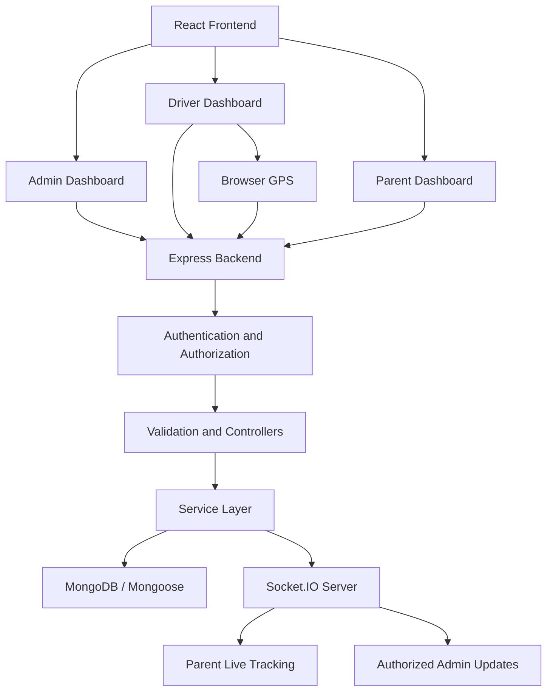

# School Van Monitoring System

A real-time school transportation monitoring platform designed to improve student safety, transportation transparency, and communication between schools, drivers, and parents.

The School Van Monitoring System enables school administrators to manage transportation operations, drivers to record student pickup and drop-off activities, and parents to monitor their children's assigned school vans through a live map.

The platform combines GPS tracking, real-time communication, OTP-verified student activity records, and role-based access control in a centralized web application.

---

## Table of Contents

1. [Project Overview](#-project-overview)
2. [Problem Statement](#-problem-statement)
3. [Project Objectives](#-project-objectives)
4. [Key Features](#-key-features)
5. [User Roles and Permissions](#-user-roles-and-permissions)
6. [System Architecture](#-system-architecture)
7. [Technology Stack](#-technology-stack)
8. [Application Workflow](#-application-workflow)
9. [GPS Tracking and Real-Time Communication](#-gps-tracking-and-real-time-communication)
10. [Student Pickup and Drop-off Management](#-student-pickup-and-drop-off-management)
11. [Project Structure](#-project-structure)
12. [Prerequisites](#-prerequisites)
13. [Installation and Local Setup](#-installation-and-local-setup)
14. [Environment Configuration](#-environment-configuration)
15. [Development Database Seeding](#-development-database-seeding)
16. [Development GPS Simulator](#-development-gps-simulator)
17. [Available Commands](#-available-commands)
18. [Testing and Verification](#-testing-and-verification)
19. [Security and Data Protection](#-security-and-data-protection)
20. [Current Limitations](#-current-limitations)
21. [Future Improvements](#-future-improvements)
22. [Documentation](#-additional-documentation)

---

## 1. Project Overview

The School Van Monitoring System is a web-based transportation monitoring solution that connects three primary stakeholders:

- **School Administrators:** Manage school transportation operations, students, parents, drivers, and vans.
- **Drivers:** Manage trips, view assigned student rosters, share their van's location, and record student pickup/drop-off activities.
- **Parents:** Monitor their children's assigned vans, receive pickup notifications, and review transportation activity history.

The system is designed around a centralized backend that manages authentication, school-specific data, trip information, GPS coordinates, and student activity records.

Parents and administrators can access relevant transportation information without directly communicating with drivers for every status update.

### Main goals

- Improve transparency in school transportation.
- Allow parents to monitor school vans in real time.
- Provide timely pickup and drop-off information.
- Maintain reliable records of student transportation activities.
- Give school administrators centralized control over transportation operations.
- Support a mobile-friendly experience suitable for schools with limited infrastructure.

---

## 2. Problem Statement

Traditional school transportation systems often depend on manual communication between parents, drivers, and school management.

This creates several problems:

- Parents may not know the current location of their child's school van.
- Drivers may not have a standardized way to report student pickup and drop-off status.
- Schools may lack centralized records of daily transportation activities.
- Parents may need to repeatedly contact drivers or school staff for updates.
- Transportation incidents and delayed pickups can be difficult to investigate without timestamped records.

The School Van Monitoring System addresses these problems through centralized transportation management, GPS tracking, and digital student activity records.

---

## 3. Project Objectives

The project focuses on the following objectives:

| Objective | Description |
|---|---|
| Real-time tracking | Allow authorized users to monitor van locations. |
| Student safety | Record student pickup and drop-off activities. |
| Transparency | Give parents access to relevant transportation information. |
| Centralized management | Allow school administrators to manage transportation operations. |
| Accountability | Maintain timestamped student activity and GPS records. |
| Accessibility | Provide a responsive interface for desktop and mobile devices. |
| Scalability | Organize the application into modular frontend and backend components. |

---

## 4. Key Features

### 4.1 School Administration

The administrator dashboard provides centralized management of school transportation.

Implemented functionality:

- School dashboard with transportation information.
- Driver account management.
- Van management and assignment.
- Parent and student account management.
- Student roster spreadsheet preview.
- All-or-nothing spreadsheet roster import.
- Student pickup location management.
- Live fleet tracking map.
- Pickup proximity alert configuration.
- Student activity and audit history.

Administrators can manage the transportation structure and monitor the operational status of their school's vehicles.

### 4.2 Driver Dashboard

The driver dashboard provides the functionality required to manage daily transportation trips.

Implemented functionality:

- View assigned driver and van information.
- View the assigned student roster.
- Start and end morning pickup trips.
- Start and end afternoon drop-off trips.
- Share GPS coordinates through browser location services.
- View student pickup and drop-off information.
- Record OTP-verified pickup events.
- Record OTP-verified drop-off events.
- Maintain timestamped student activity records.

Drivers can only operate within their assigned transportation resources.

### 4.3 Parent Dashboard

The parent dashboard provides visibility into their children's school transportation activities.

Implemented functionality:

- View linked student information.
- Monitor the assigned van's location.
- Receive authorized real-time location updates.
- Receive pickup proximity alerts.
- View student pickup and drop-off status.
- Review transportation activity history.

The parent interface is designed to make essential transportation information easy to access, especially on mobile devices.

### 4.4 Backend and Real-Time Services

The backend coordinates communication between all application roles.

Implemented functionality:

- JWT-based authentication.
- Role-based authorization.
- School-scoped data access.
- Input validation using Zod.
- MongoDB persistence using Mongoose.
- GPS location history.
- Socket.IO communication.
- Active trip management.
- Pickup proximity alert processing.
- Configurable location freshness thresholds.
- OTP-based student activity verification.

---

## 5. User Roles and Permissions

The system uses role-based access control to separate functionality and protect school transportation data.

| Feature | Admin | Driver | Parent |
|---|:---:|:---:|:---:|
| Access admin dashboard | Yes | No | No |
| Manage drivers | Yes | No | No |
| Manage vans | Yes | No | No |
| Manage students | Yes | No | No |
| Manage parents | Yes | No | No |
| View assigned roster | Yes | Yes | Linked students |
| Start/end trips | No | Yes | No |
| Send GPS updates | No | Yes | No |
| View live van location | Yes | Assigned van | Assigned van |
| Record pickup/drop-off | No | Yes | No |
| View activity history | Yes | Assigned records | Linked students |

### Authentication and authorization

Users authenticate through the backend using their credentials.

The backend issues a JWT access token after successful authentication.

Protected requests include the token in the authorization header:

```http
Authorization: Bearer <access_token>
```

The backend verifies the token and checks the user's role and resource ownership before allowing access.

Important security rules:

- Users cannot select their own role through an untrusted request body.
- Drivers cannot access other drivers' assignments.
- Parents cannot access unrelated students.
- School administrators cannot access another school's records.
- Protected APIs perform authorization on the backend rather than relying only on frontend route protection.

---

## 6. System Architecture

The application follows a client-server architecture.

The frontend handles user interaction and visualization, while the backend handles business logic, authentication, validation, and database operations.

### Architecture overview



### Backend request lifecycle

The backend follows a structured request-processing flow:

```text
Incoming HTTP Request
        |
        v
      Route
        |
        v
 Authentication / Authorization
        |
        v
     Validation
        |
        v
    Controller
        |
        v
     Service
        |
        v
  Model / Database
        |
        v
   API Response
```

This separation keeps responsibilities organized:

- **Routes:** Define API endpoints and middleware.
- **Middleware:** Handle authentication, authorization, and request validation.
- **Controllers:** Handle HTTP request and response operations.
- **Services:** Implement application business logic.
- **Models:** Define MongoDB document structures and database interactions.

### Real-time communication

Socket.IO is used for real-time transportation updates.

Instead of repeatedly requesting the same location through HTTP, authorized clients can receive location updates when the backend broadcasts accepted GPS changes.

REST APIs remain available for initial data loading and periodic refresh.

---

## 7. Technology Stack

### Frontend

| Technology | Purpose |
|---|---|
| React | Component-based user interface |
| Vite | Frontend development server and build tool |
| Tailwind CSS | Responsive styling |
| React Router | Client-side navigation |
| Axios | HTTP communication with backend APIs |
| Leaflet | Interactive map visualization |
| OpenStreetMap | Map tile and geographic data provider |
| Socket.IO Client | Real-time communication |

### Backend

| Technology | Purpose |
|---|---|
| Node.js | JavaScript runtime |
| Express.js | Backend web framework |
| MongoDB | Database |
| Mongoose | MongoDB object modeling |
| JWT | Authentication tokens |
| bcryptjs | Password hashing |
| Zod | Request and data validation |
| Socket.IO | Real-time communication |

### Development tools

- Git and GitHub for version control.
- npm for package management.
- Nodemon for backend development.
- Node.js built-in testing tools.
- MongoDB for local or hosted database storage.

---

## 8. Application Workflow

### 8.1 School administration workflow

1. The school administrator logs into the application.
2. The administrator accesses the school dashboard.
3. Drivers, vans, parents, and students are managed.
4. Students are assigned to their respective vans.
5. Drivers are associated with their assigned vans.
6. Student pickup locations are configured.
7. Administrators monitor active transportation operations through the fleet map.
8. Student activity records can be reviewed when required.

### 8.2 Driver workflow

1. The driver logs in using their assigned credentials.
2. The driver views their assigned van and student roster.
3. The driver starts a morning pickup or afternoon drop-off trip.
4. The browser requests location permission.
5. The application collects GPS coordinates while the trip is active.
6. Coordinates are sent to the backend.
7. The driver records student pickup/drop-off activities using OTP verification.
8. Student activity records are saved with timestamps.
9. The driver ends the trip.

### 8.3 Parent workflow

1. The parent logs in.
2. The dashboard displays linked student information.
3. The parent views the assigned van's current location.
4. Location updates arrive through Socket.IO when authorized.
5. The parent can receive pickup proximity alerts.
6. The parent can review student pickup/drop-off history.

---

## 9. GPS Tracking and Real-Time Communication

GPS tracking is one of the central components of the application.

### 9.1 How GPS tracking works

The driver's browser uses the browser Geolocation API to obtain device coordinates.

The frontend tracks location changes and sends accepted coordinate updates to the backend.

The location request uses:

```http
POST /api/vans/:vanId/location
```

The backend verifies:

- The user is authenticated.
- The user has the driver role.
- The van belongs to the driver's school.
- The van is assigned to the driver.
- The trip is active.
- The coordinates are valid.
- The location update satisfies rate and timestamp checks.

Only accepted location updates are persisted and broadcast.

### 9.2 GPS data processing

The backend stores location updates in MongoDB through the location model.

Location records include geographic coordinates and timestamp information.

The system also uses location updates for pickup proximity alert processing.

### 9.3 Real-time updates

After an accepted GPS update:

1. The backend stores the location.
2. The Socket.IO server broadcasts the update.
3. Authorized trip subscribers receive the event.
4. The parent dashboard updates its map.
5. The admin dashboard reflects the latest location through its periodic refresh mechanism.

Socket.IO access is restricted to authorized users.

### 9.4 Location freshness

GPS information can become outdated when a driver loses connectivity or stops sharing location.

The application includes a configurable location freshness threshold:

```env
LOCATION_STALE_THRESHOLD_SECONDS=...
```

This helps distinguish recent location information from potentially outdated coordinates.

### 9.5 Pickup proximity alerts

The backend processes accepted location updates against configured student pickup locations.

Pickup proximity behavior is controlled through:

```env
PICKUP_ALERT_RADIUS_METERS=...
```

The administrator can configure pickup-alert settings through the management interface.

---

## 10. Student Pickup and Drop-off Management

Student transportation activities are recorded digitally rather than depending entirely on manual communication.

### OTP verification

The application supports OTP-verified pickup and drop-off events.

The general process is:

1. The driver selects the relevant student.
2. The driver initiates the appropriate activity.
3. The OTP verification process is completed.
4. The backend validates the submitted verification information.
5. The student activity is recorded.
6. The event receives a timestamp.
7. Authorized users can review the activity information.

### Activity history

Student activity records help maintain transportation accountability.

Relevant information includes:

- Student reference.
- Associated van and trip.
- Activity type.
- Activity timestamp.
- Verification information and event status, as supported by the implementation.

These records support the admin activity and audit-history workflow.

**Important:** GPS location history and student activity history are separate concepts. A GPS update does not automatically mean a student has been picked up or dropped off.

---

## 11. Project Structure

The repository is organized into separate frontend and backend applications.

```text
school-van-monitor/
│
├── client/
│   ├── public/
│   ├── src/
│   │   ├── components/
│   │   │   ├── admin/
│   │   │   ├── driver/
│   │   │   └── parent/
│   │   │
│   │   ├── context/
│   │   ├── pages/
│   │   ├── services/
│   │   ├── utils/
│   │   └── ...
│   │
│   ├── package.json
│   └── ...
│
├── server/
│   ├── modules/
│   │   ├── auth/
│   │   ├── van/
│   │   ├── location/
│   │   └── ...
│   │
│   ├── src/
│   │   ├── middleware/
│   │   ├── utils/
│   │   └── ...
│   │
│   ├── scripts/
│   │   └── demo-gps-simulator.js
│   │
│   ├── test/
│   ├── .env.example
│   └── package.json
│
├── docs/
│   ├── API_CONTRACT.md
│   ├── DATABASE_SCHEMA.md
│   ├── REALTIME_CONTRACT.md
│   ├── TEST_PLAN.md
│   ├── DEVELOPMENT_SEED.md
│   └── DEMO_GPS_SIMULATOR.md
│
└── README.md
```

### Important directories

**client/src/components/**

Contains reusable UI components organized around application roles.

**client/src/pages/**

Contains the main application pages and dashboard screens.

**client/src/context/**

Contains shared frontend state and authentication context.

**client/src/services/**

Contains frontend API communication logic.

**server/modules/**

Contains backend feature modules and their associated routes, controllers, services, and models.

**server/src/middleware/**

Contains shared backend middleware for authentication, authorization, validation, and request processing.

**server/scripts/**

Contains development and maintenance scripts, including the GPS simulator.

**server/test/**

Contains backend automated tests.

**docs/**

Contains technical documentation, API contracts, database design, testing guides, and development instructions.

---

## 12. Prerequisites

Before installing the project, ensure the following software is available:

| Requirement | Version |
|---|---|
| Node.js | 20 or newer |
| npm | Included with Node.js |
| MongoDB | Local installation or accessible database |
| Git | Recent version |
| Web browser | Modern browser with Geolocation API support |

A code editor such as Visual Studio Code is recommended.

---

## 13. Installation and Local Setup

Follow these instructions to run the application locally.

### Step 1: Clone the repository

```bash
git clone <YOUR_REPOSITORY_URL>
cd school-van-monitor
```

Replace the placeholder with the actual GitHub repository URL.

### Step 2: Configure the backend environment

Navigate to the backend directory:

```bash
cd server
```

Create a local environment file:

```powershell
Copy-Item .env.example .env
```

Open `server/.env` and configure the required values.

At minimum, configure:

```env
NODE_ENV=development
PORT=5000

MONGODB_URI=your_local_mongodb_connection_string

JWT_ACCESS_SECRET=your_secure_random_secret
```

Keep all actual credentials and secrets inside the local `.env` file.

### Step 3: Install backend dependencies

From the `server/` directory:

```bash
npm install
```

### Step 4: Start the backend

```bash
npm run dev
```

The backend runs on port 5000 by default.

Check backend health:

```http
GET http://localhost:5000/api/health
```

A successful health response indicates that the API health endpoint is responding. Check the backend logs separately to confirm MongoDB connectivity.

### Step 5: Install frontend dependencies

Open a second terminal:

```bash
cd client
npm install
```

### Step 6: Start the frontend

```bash
npm run dev
```

Vite displays the frontend development URL in the terminal.

Open that URL in your browser.

### Step 7: Verify the application

Check the following:

- Frontend loads successfully.
- Backend API responds.
- MongoDB connection succeeds.
- Login page is accessible.
- Role-specific navigation works.
- Protected dashboards enforce their role restrictions.

**Note:** The frontend development configuration proxies API and Socket.IO traffic to the backend on port 5000 by default.

---

## 14. Environment Configuration

The complete environment variable reference is maintained in:

`server/.env.example`

Important configuration categories include:

### Core configuration

| Variable | Purpose |
|---|---|
| `NODE_ENV` | Controls the application environment. |
| `PORT` | Backend server port. |
| `MONGODB_URI` | MongoDB connection string. |
| `JWT_ACCESS_SECRET` | Secret used for JWT access-token signing. |
| `CLIENT_ORIGIN` | Configures the permitted frontend origin. |

### Email and OTP configuration

| Variable | Purpose |
|---|---|
| SMTP-related settings | Configure email delivery. |
| `OTP_HASH_SECRET` | Secret used for OTP-related hashing operations. |

SMTP credentials must be configured for actual email delivery.

### GPS and alert configuration

| Variable | Purpose |
|---|---|
| `LOCATION_STALE_THRESHOLD_SECONDS` | Defines the location freshness threshold. |
| `PICKUP_ALERT_RADIUS_METERS` | Defines the pickup proximity radius. |

### Development configuration

| Variable | Purpose |
|---|---|
| `DEV_DEMO_PASSWORD` | Password used for seeded development accounts. |
| `DEMO_GPS_SIMULATOR_ENABLED` | Explicitly enables the development GPS simulator. |
| `DEMO_GPS_ROUTE_DURATION_MINUTES` | Controls simulated route duration. |
| `DEMO_GPS_INTERVAL_MS` | Controls the interval between GPS updates. |
| `DEMO_GPS_STOP_DURATION_MS` | Controls pauses at selected route points. |
| `DEMO_GPS_API_URL` | Optional local API origin for simulator requests. |

Never commit real credentials, tokens, database passwords, or production environment files.

---

## 15. Development Database Seeding

The project includes a development seed script for generating fictional school transportation data.

### Purpose

The seed script makes local development and demonstration easier by creating or reusing:

- A fictional school.
- A school administrator.
- Three demo drivers.
- Three demo parents.
- Demo vans.
- Linked students and transportation assignments.

### Configuration

In `server/.env`, configure:

```env
NODE_ENV=development

MONGODB_URI=your_local_mongodb_connection_string

DEV_DEMO_PASSWORD=your_private_password_of_at_least_12_characters
```

### Execute the seed script

Run from the `server/` directory:

```bash
npm run seed:dev
```

The script creates or reuses the fictional development records.

### Important seed behavior

- Refuses non-local databases.
- Reuses existing development records where appropriate.
- Does not overwrite existing account passwords.
- Does not create active trips.
- Does not generate GPS history.
- Does not create pickup coordinates automatically.

Therefore, active trips and pickup locations must be configured separately before testing GPS tracking and pickup alerts.

For detailed information, see:

[Development Seed Guide](docs/DEVELOPMENT_SEED.md)

---

## 16. Development GPS Simulator

The project includes a development-only GPS simulator for realistic van movement demonstrations.

It allows developers and hackathon presenters to simulate a moving school van without requiring a physical vehicle.

### How it works

The simulator:

1. Connects to the local development API.
2. Verifies that the selected van is one of the seeded demo vans.
3. Verifies the corresponding seeded driver and active trip.
4. Confirms the driver's assignment and trip through the API.
5. Generates a sequence of GPS coordinates.
6. Sends coordinates through the existing authenticated location endpoint.
7. Allows the normal backend location pipeline to process the updates.

### Supported demo vans

```text
CG-DEMO-001
CG-DEMO-002
CG-DEMO-003
```

### Default simulation configuration

| Setting | Default |
|---|---:|
| GPS updates | 44 points |
| Route movement duration | 5 minutes |
| Update interval | 7 seconds |
| Route pauses | 3 |
| Pause duration | 17 seconds |
| Total duration | Approximately 5 minutes 51 seconds |

### Configuration

Add the following settings to `server/.env`:

```env
DEMO_GPS_SIMULATOR_ENABLED=true

DEMO_GPS_ROUTE_DURATION_MINUTES=5
DEMO_GPS_INTERVAL_MS=7000
DEMO_GPS_STOP_DURATION_MS=17000
```

Supported ranges:

| Variable | Minimum | Maximum |
|---|---:|---:|
| `DEMO_GPS_ROUTE_DURATION_MINUTES` | 3 | 20 |
| `DEMO_GPS_INTERVAL_MS` | 2500 ms | 30000 ms |
| `DEMO_GPS_STOP_DURATION_MS` | 0 ms | 120000 ms |

Set the stop duration to `0` to disable pauses.

The simulator also requires development mode, a local database, a local API, and the correct demo driver password.

### Running the simulator

**Important:** Before running the simulator, make sure the demo van has an active trip.

Also, stop the driver's browser GPS watcher to prevent real browser GPS updates from interfering with simulated coordinates.

From the `server/` directory, run:

```bash
npm run simulate:gps -- CG-DEMO-001
```

Replace the van ID with another supported demo van when needed.

### Expected behavior

During the simulation:

- The van moves along the preset route.
- GPS updates are sent at the configured interval.
- The van pauses at selected route points.
- Parents receive authorized Socket.IO location updates.
- The admin tracking page reflects the latest location through its existing refresh cycle.
- Accepted GPS coordinates are saved through the normal location service.

### Important safety considerations

- The simulator is intended only for development and demonstrations.
- It does not modify production GPS tracking.
- It does not bypass authentication or authorization.
- It does not generate automatic student pickup/drop-off events.
- Normal location processing may still trigger configured pickup proximity alerts.
- Simulated GPS history remains in the local demo database.

For complete setup instructions and implementation details:

[Development GPS Simulator Guide](docs/DEMO_GPS_SIMULATOR.md)

---

## 17. Available Commands

Run frontend commands from `client/` and backend commands from `server/`.

### Frontend commands

| Command | Description |
|---|---|
| `npm install` | Install frontend dependencies. |
| `npm run dev` | Start the Vite development server. |
| `npm run build` | Generate production frontend assets. |
| `npm run preview` | Preview the production build locally. |

### Backend commands

| Command | Description |
|---|---|
| `npm install` | Install backend dependencies. |
| `npm run dev` | Start the backend in development mode. |
| `npm start` | Start the backend normally. |
| `npm test` | Run backend automated tests. |
| `npm run seed:admin` | Run the admin seed script. |
| `npm run seed:dev` | Generate fictional development data. |
| `npm run simulate:gps -- CG-DEMO-001` | Run the development GPS simulator. |
| `npm run test:seed:db` | Run seed database tests using a dedicated `MONGODB_TEST_URI` database. |

### Code quality

The current `lint` scripts are placeholders. ESLint is not configured, and the frontend does not currently have a test script.

---

## 18. Testing and Verification

Testing is important because the application handles student transportation information and role-specific access.

### Backend automated tests

Run:

```bash
cd server
npm test
```

The backend test suite covers implemented application functionality, including authentication, GPS services, and other backend modules.

### Development GPS simulator tests

The simulator has focused automated tests covering:

- Simulator opt-in requirements.
- Demo van restrictions.
- Active trip validation.
- Driver and van assignment checks.
- GPS coordinate progression.
- Timestamp ordering.
- Update pacing.
- Parent Socket.IO delivery.
- Admin location retrieval.
- Existing authentication and GPS behavior.

### Manual verification checklist

#### Admin

- [ ] Admin can log in.
- [ ] Admin dashboard loads.
- [ ] Driver and van management works.
- [ ] Parent and student management works.
- [ ] Student roster import works.
- [ ] Pickup locations can be configured.
- [ ] Live fleet tracking works.
- [ ] Student activity history is accessible.

#### Driver

- [ ] Driver can log in.
- [ ] Driver sees the correct assigned van.
- [ ] Driver sees the correct student roster.
- [ ] Morning trip can be started and ended.
- [ ] Afternoon trip can be started and ended.
- [ ] Browser GPS tracking works.
- [ ] OTP-verified pickup and drop-off actions work.
- [ ] Student activity timestamps are recorded.

#### Parent

- [ ] Parent can log in.
- [ ] Parent sees only linked students.
- [ ] Assigned van appears on the map.
- [ ] Real-time location updates work.
- [ ] Pickup alerts work when configured.
- [ ] Pickup and drop-off history is visible.

#### GPS Simulator

- [ ] Simulator refuses to run without explicit enablement.
- [ ] Simulator refuses unsupported vans.
- [ ] Simulator refuses vans without active trips.
- [ ] Simulated GPS updates are accepted.
- [ ] Parent map receives updates.
- [ ] Admin tracking reflects updated locations.
- [ ] GPS history is persisted.
- [ ] Manual student status actions remain separate.

### Current verification status

The expanded development GPS simulator's focused test suite has passed 49 tests.

Live MongoDB persistence and actual browser-based map behavior still require manual verification.

The previously reported full test-suite run had 87 passes and 2 failures:

1. The standalone trip-status test required `TEST_PARENT_TOKEN`.
2. An existing driver-list test expected a query shape that did not match the implementation.

These should be investigated and verified independently before treating the complete test suite as passing.

---

## 19. Security and Data Protection

Student transportation information requires careful handling.

The application follows several security principles:

### Authentication

- JWT-based authentication.
- Password hashing using bcryptjs.
- Protected backend routes.
- Authenticated GPS updates.

### Authorization

- Role-based access restrictions.
- School-scoped resource access.
- Driver-to-van assignment verification.
- Parent-to-student ownership verification.
- Authorized Socket.IO trip subscriptions.

### Input validation

- Request validation using Zod.
- Coordinate validation.
- GPS timestamp ordering checks.
- GPS update rate limiting.
- Server-side ownership verification.

### Data handling

- Avoid using real student information in development demonstrations.
- Keep environment files and secrets outside version control.
- Use fictional student records for demos.
- Restrict access to location and student activity records.
- Define suitable retention and deletion policies before production deployment.

---

## 20. Current Limitations

The following points should be considered when evaluating the current implementation.

### GPS and maps

- The GPS simulator follows a preset coordinate sequence.
- It does not perform turn-by-turn road routing.
- The simulator is development-only.
- Browser GPS requires location permission and a supported browser environment.
- Real-time location accuracy depends on device GPS and network connectivity.

### Notifications

- SMTP configuration is required for email delivery.
- SMS and paid push notification providers are not configured.

### Testing

- There is no frontend automated test script.
- ESLint is not configured.
- Live MongoDB and browser-based end-to-end GPS verification remain necessary.

### Deployment

Production deployment requires environment-specific configuration for:

- Database hosting.
- Secure secrets.
- HTTPS.
- Frontend and backend hosting.
- CORS and Socket.IO origins.
- Monitoring and logging.
- Database backups.
- Privacy and data retention.
- Operational support.

The project should not be considered production-ready solely because local development features work.

---

## 21. Future Improvements

Potential improvements for future development include:

### GPS and transportation

- Road-aware route visualization.
- Multiple configurable demo routes.
- Improved location smoothing.
- Better handling of poor network connectivity.
- Offline GPS buffering and synchronization.

### Parent experience

- More detailed transportation notifications.
- Improved trip progress visualization.
- Better historical trip summaries.
- Additional notification preferences.

### Administration

- Advanced transportation reports.
- Student attendance analytics.
- Historical route analysis.
- More detailed audit reporting.

### Infrastructure

- Production deployment automation.
- Monitoring and error reporting.
- Automated frontend and backend integration tests.
- Improved backup and recovery procedures.

These are potential improvements and should not be interpreted as currently implemented features.

---

## 22. Additional Documentation

The `docs/` directory contains detailed technical documentation for development and maintenance.

| Document | Description |
|---|---|
| [API Contract](docs/API_CONTRACT.md) | Backend endpoints, request formats, and response conventions. |
| [Database Schema](docs/DATABASE_SCHEMA.md) | Database collections, models, and relationships. |
| [Realtime Contract](docs/REALTIME_CONTRACT.md) | Socket.IO events, communication rules, and access expectations. |
| [Manual Test Plan](docs/TEST_PLAN.md) | Manual verification procedures and test scenarios. |
| [Development Seed Guide](docs/DEVELOPMENT_SEED.md) | Instructions for generating fictional development data. |
| [GPS Simulator Guide](docs/DEMO_GPS_SIMULATOR.md) | GPS simulator configuration, execution, and safety restrictions. |

---

## Project Status

The School Van Monitoring System includes separate administrator, driver, and parent workflows, backend authentication and authorization, GPS tracking, real-time communication, and student activity management.

Development tools, including fictional database seeding and GPS simulation, support local testing and hackathon demonstrations.

Further integration testing, deployment configuration, and operational security work are required before production use.

---

**Built to improve school transportation safety, transparency, and accountability.**
